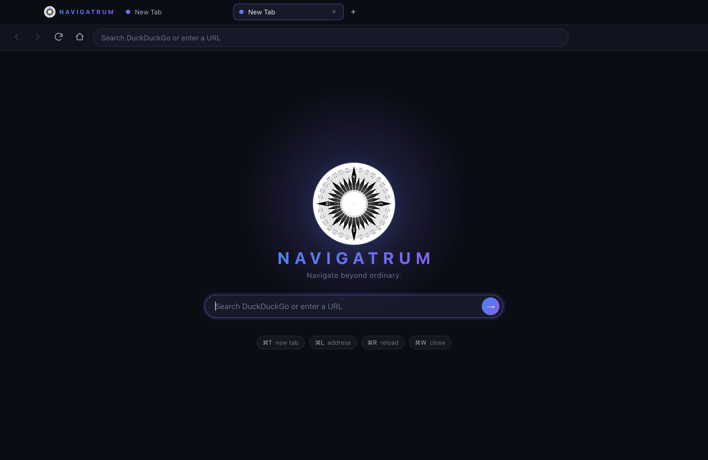
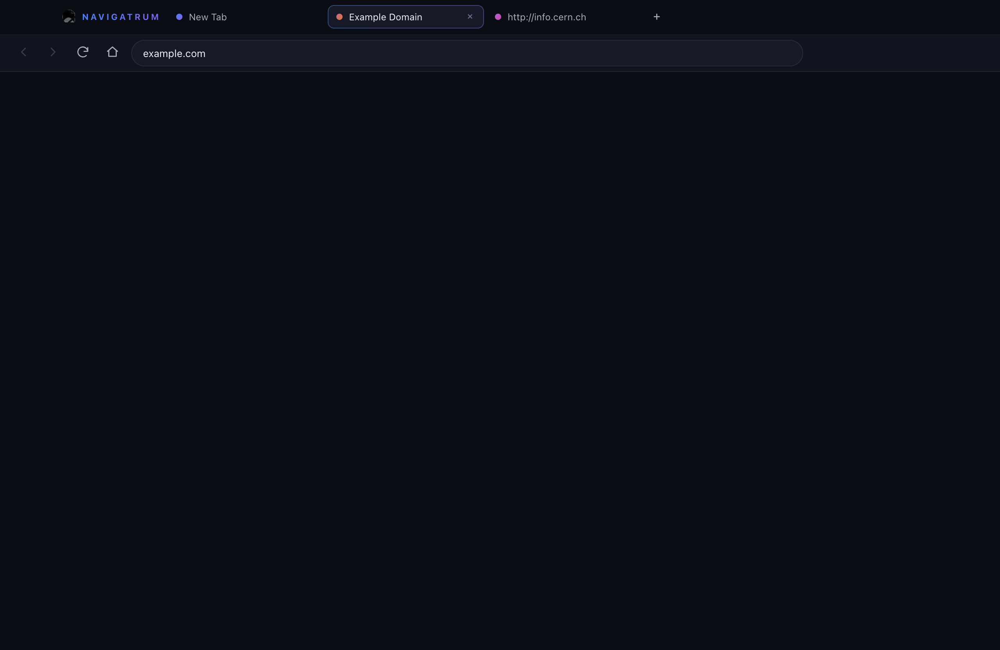
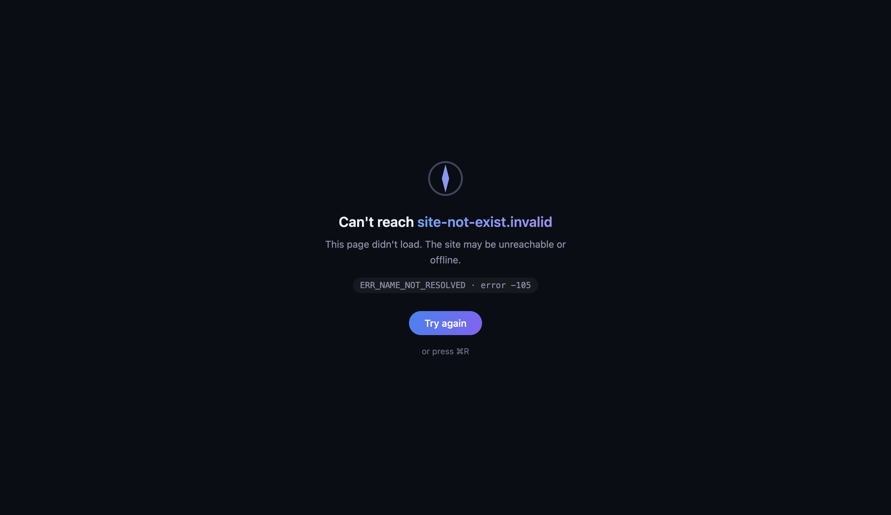

# NAVIGATRUM

> Navigate beyond ordinary.

NAVIGATRUM is an open-source, desktop browser built with **Electron**, **React**,
**TypeScript** and **Vite**. macOS first, with Windows and Linux planned.
Licensed under the [MIT License](LICENSE).



## Features (Milestone 2)

- **Real browser engine** — every tab is an independent `WebContentsView`
  rendering live web pages.
- **Multiple tabs** — create (`⌘T`), close (`⌘W`), switch (`⌘1`–`9`,
  `Ctrl+Tab`, click), middle-click to close. Middle-click links that open
  popups become new NAVIGATRUM tabs.
- **Address bar** — navigate URLs directly or search with
  **DuckDuckGo** by default (`⌘L` to focus).
- **Navigation** — back (`⌘[`), forward (`⌘]`), reload (`⌘R`), stop,
  home, and a built-in new-tab/home screen with compass branding.
- **Loading indicators** — animated progress bar while any page loads.
- **Error pages** — self-contained dark-themed error screen with error code
  and working "Try again" recovery.
- **Secure by default** — `contextIsolation: true`, `nodeIntegration: false`,
  `sandbox: true`, `webSecurity` on, a minimal typed `contextBridge` API,
  IPC validation in the main process, popups/`<webview>`/permissions denied
  unless explicitly handled.



## Getting started

Requirements: **macOS 13+** (Intel or Apple Silicon), **Node.js ≥ 22.12**.

```bash
npm install        # install dependencies (downloads the Electron runtime)
npm run dev        # start NAVIGATRUM in development mode
```

### Scripts

| Script              | What it does                                        |
| ------------------- | --------------------------------------------------- |
| `npm run dev`       | Dev mode with hot reload for the chrome UI          |
| `npm run build`     | Production build (main + preload + renderer)        |
| `npm run start`     | Typecheck, production build, then launch the app    |
| `npm run typecheck` | TypeScript checks for main/preload and renderer     |

## Architecture

```
src/
├── main/         Electron main process
│   ├── index.ts        app bootstrap, single-instance lock, global hardening
│   ├── window.ts       hiddenInset BrowserWindow + secure webPreferences
│   ├── tab-manager.ts  WebContentsView tabs, bounds, events, accelerators
│   ├── ipc.ts          validated IPC surface
│   ├── navigation.ts   URL vs. search resolution (DuckDuckGo)
│   └── error-page.ts   self-contained error page (data: URL)
├── preload/      sandboxed contextBridge exposing `window.navigatrum`
├── renderer/     React chrome: tab strip, toolbar, address bar, home screen
└── shared/       constants + types shared across processes
assets/brand/     compass artwork, generated macOS .icns
```

The chrome (tabs + toolbar) is the window's React renderer; page content
lives in one `WebContentsView` per tab in the main process. The renderer
only ever receives plain state snapshots over IPC — it holds no references
to `webContents`.



## Roadmap

- [x] M1 — Electron + React + TypeScript + Vite foundation
- [x] M2 — Browser window, tabs, address bar, navigation
- [ ] M3 — Bookmarks, history, downloads, persistent sessions
- [ ] M4 — Compass branding polish + packaging
- [ ] M5 — AI Connections (secure provider/key management)
- [ ] M6 — AI sidebar & assistant
- [ ] M7 — Release engineering, docs, first GitHub release

## Contributing

PRs welcome. Keep commits scoped, run `npm run typecheck && npm run build`
before pushing, and never commit credentials or build output.
