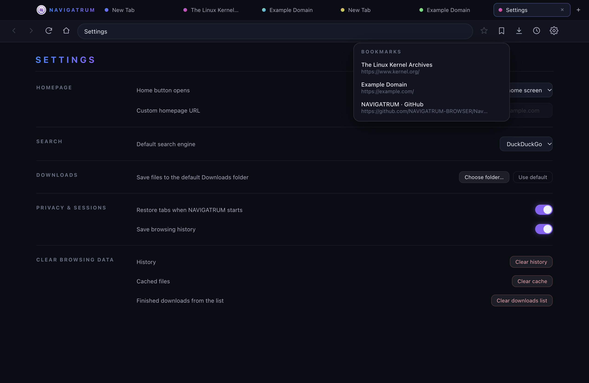
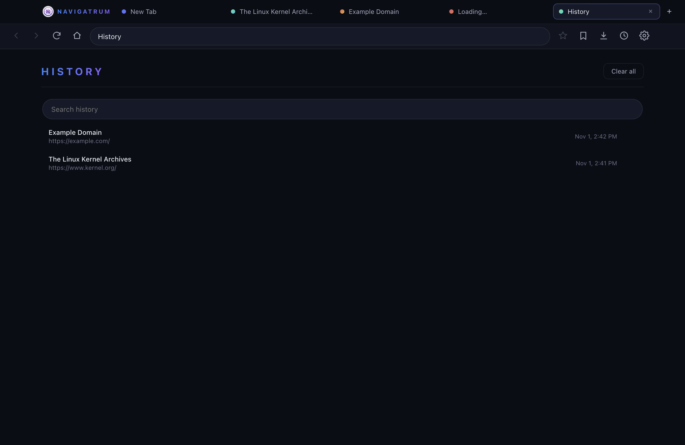
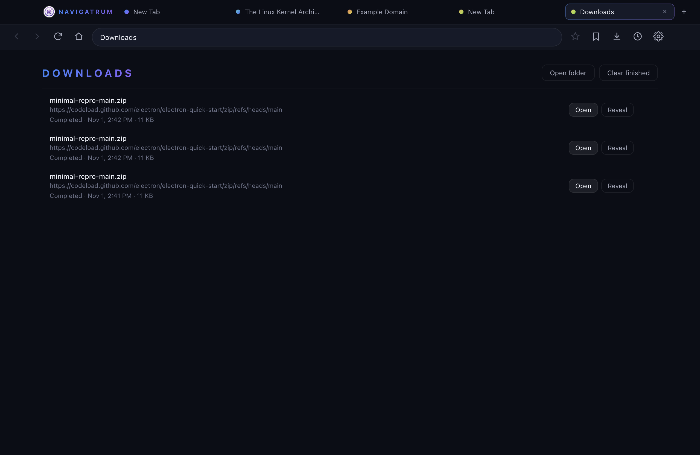
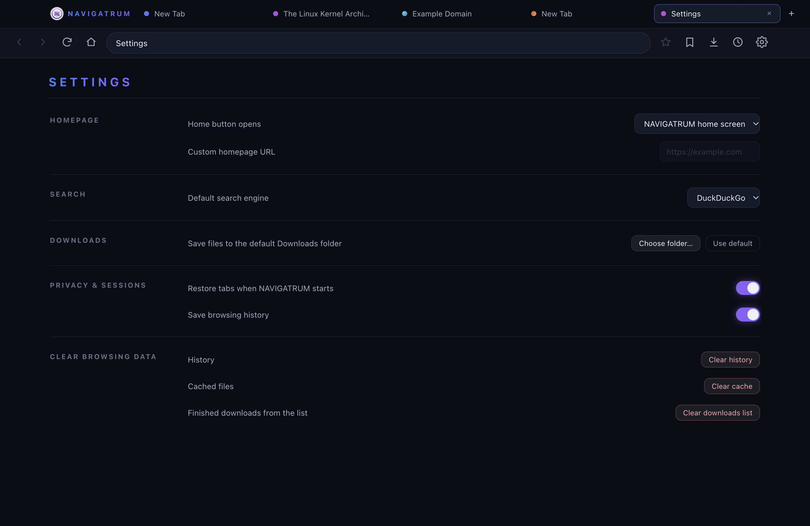

# NAVIGATRUM

> Navigate beyond ordinary.

NAVIGATRUM is an open-source, desktop browser built with **Electron**, **React**,
**TypeScript** and **Vite**. macOS first, with Windows and Linux planned.
Licensed under the [MIT License](LICENSE).


## Core browsing (Milestone 2)

- **Real browser engine** — every tab is an independent `WebContentsView`
  rendering live web pages.
- **Multiple tabs** — create (`⌘T`), close (`⌘W`), switch (`⌘1`–`9`,
  `Ctrl+Tab`, click), middle-click to close. Middle-click links that open
  popups become new NAVIGATRUM tabs.
- **Address bar** — navigate URLs directly or search with the chosen
  default engine (`⌘L` to focus).
- **Navigation** — back (`⌘[`), forward (`⌘]`), reload (`⌘R`), stop,
  home, and a built-in new-tab/home screen with compass branding.
- **Loading indicators** — animated progress bar while any page loads.
- **Error pages** — self-contained dark-themed error screen with error code
  and working "Try again" recovery.
- **Secure by default** — `contextIsolation: true`, `nodeIntegration: false`,
  `sandbox: true`, `webSecurity` on, a minimal typed `contextBridge` API,
  IPC validation in the main process, popups/`<webview>`/permissions denied
  unless explicitly handled.


## Browser essentials (Milestone 3)

New in this milestone:

- **Bookmarks** — star the current page (or un-star it), open the bookmark
  menu from the toolbar, and remove or open saved bookmarks. Titles and URLs
  are stored locally and de-duplicated.
- **Browsing history** — every real page visit is recorded with a timestamp,
  backfilled with its page title, and searchable on the built-in History
  page (`⌘Y`). Delete individual entries or clear everything; internal
  pages and error states are never recorded.
- **Download manager** — downloads are handled by Electron's download APIs
  and saved silently (never overwriting an existing file). The Downloads
  page (`⌘J`) shows filename, size, live progress and status, with Open,
  Reveal in Finder, Cancel, and Clear actions; active downloads also show a
  live badge on the toolbar.
- **Persistent sessions** — tabs and the active tab are restored after a
  restart, can be disabled in Settings, and unavailable URLs land on the
  built-in error page.
- **Settings** (`⌘,`) — homepage selection (compass home or custom URL),
  default search engine (DuckDuckGo, Google, Bing, Brave), download folder,
  session-restore toggle, and clear-browsing-data controls (history, cache,
  downloads list).
- **Data isolation** — browser data (bookmarks, history, settings, session)
  lives in the app's own `userData/store/*.json`, never exposed to websites.
- **Data isolation** — browser data (bookmarks, history, settings, session)
  lives in the app's own `userData/store/*.json`, never exposed to websites.









## Touch Bar + packaging (Milestone 4)

NAVIGATRUM drives the MacBook Pro Touch Bar natively (Electron's TouchBar
API — no fake bar inside the browser window):

- **Tab switcher first** — every open tab appears in a scrolling scrubber
  row with its live **favicon** and a compact title; tapping a tile
  switches instantly. The row always mirrors the real tab registry —
  closed tabs vanish immediately, new tabs appear immediately, and any
  number of open tabs scrolls gracefully.
- **Address chip** — Safari-style accent-colored chip showing the active
  tab's host (or the internal page name); the dependable highlight for
  the tab on screen.
- **Controls** — Reload/Stop (⏳ flips to ■ while a page loads), bookmark
  star, and a New Tab button.
- **NAVIGATRUM AI** — the violet ✦ button opens the built-in
  `navigatrum://ai` page: the landing point for AI Connections (M5).
- **Brand glows** — switching, creating or closing tabs and starring a
  bookmark pulse violet → blue (stepped colors: macOS exposes no
  keyframe API for Touch Bar controls).
- The compass app icon now ships with **rounded, transparent corners**
  across the Dock, Finder and every in-app surface.

Packaging: `npm run package` runs typecheck + production build and writes
`release/NAVIGATRUM-darwin-x64/NAVIGATRUM.app` (Electron 45, unsigned) —
double-click to run.

## AI Connections (Milestone 5)

The `✦ AI` page (and Settings → "AI Connections →") is now the unified
provider connection surface — the infrastructure the future AI assistant
will be built on (chat itself is Milestone 6):

- **One simple connect flow** — pick a provider (or let NAVIGATRUM detect
  it from the key's unique prefix), paste one API key, press Connect.
  Ollama and generic OpenAI-compatible endpoints accept a custom base URL;
  Ollama needs no key at all.
- **Verified connections only** — a key is probed against that provider's
  **official** models/account endpoint (OpenAI, Google Gemini, Anthropic,
  OpenRouter, NVIDIA NIM, Groq, Together AI, Mistral, Cohere, xAI, Ollama)
  and a connection is only recorded after an HTTP 200 verification. Invalid
  keys, rate limits, network failures and provider outages each map to a
  distinct, human-readable error; a key is never sent to any endpoint
  outside its own provider.
- **Keys stay in the main process** — after verification, keys are encrypted
  through Electron `safeStorage` (macOS Keychain) and stored as blobs in
  the app's private userData. The renderer never sees key material; every
  IPC call is validated and length-capped; nothing is logged or hardcoded.
- **Connected providers list** — live status with Cloud/Local/Default
  badges, verification time and model counts, plus Disconnect and
  Replace-key (re-verified before the stored key is swapped).
- **Model management** — the provider's real model list is fetched and
  cached, a default provider + model can be chosen, and local (Ollama) vs
  cloud models are labeled explicitly.
- **Provider-independent service layer** — `src/main/ai/` separates the
  provider registry, encrypted key vault and connections service, so the
  Milestone 6 assistant can switch providers without any UI or browser
  integration change.

## Getting started

Requirements: **macOS 13+** (Intel or Apple Silicon), **Node.js ≥ 22.12**.

```bash
npm install        # install dependencies (downloads the Electron runtime)
npm run dev        # start NAVIGATRUM in development mode
```

### Scripts

| Script              | What it does                                        |
| ------------------- | --------------------------------------------------- |
| `npm run dev`       | Dev mode with hot reload for the chrome UI          |
| `npm run build`     | Production build (main + preload + renderer)        |
| `npm run start`     | Typecheck, production build, then launch the app    |
| `npm run typecheck` | TypeScript checks for main/preload and renderer     |
| `npm run package`   | Typecheck + build + macOS app bundle into `release/` |

## Architecture

```
src/
├── main/         Electron main process
│   ├── index.ts          app bootstrap, session restore/save, quit flushing
│   ├── window.ts         hiddenInset BrowserWindow + secure webPreferences
│   ├── tab-manager.ts    WebContentsView tabs, history hooks, downloads
│   ├── ipc.ts            validated IPC surface (tabs/bookmarks/history/
│   │                     downloads/settings/data/ai connections)
│   ├── navigation.ts     URL vs. search resolution (per chosen engine)
│   ├── downloads.ts      download registry, lifecycle, open/cancel/reveal
│   ├── ai/               AI Connections (Milestone 5)
│   │   ├── providers.ts  provider registry: official verify/models
│   │   │                 endpoints, auth styles, key-prefix auto-detection
│   │   ├── keys.ts       safeStorage-encrypted key vault (no plaintext)
│   │   └── connections.ts  provider-independent service: verify, connect,
│   │                     models, defaults — the future assistant's API
│   ├── history-store.ts  visit recording, titles, capped persistence
│   ├── bookmarks-store.ts
│   ├── settings-store.ts validated settings + search-engine table
│   ├── session-store.ts  saved tabs + active index
│   ├── touch-bar.ts      native macOS Touch Bar + favicon cache
│   ├── brand.ts          bundled brand artwork resolver
│   ├── store.ts          buffered JSON persistence with quit-time flush
│   └── error-page.ts     self-contained error page (data: URL)
├── preload/      sandboxed contextBridge exposing `window.navigatrum`
├── renderer/     React chrome: tab strip, toolbar, address bar, home
│                 screen, and the built-in history/downloads/settings/ai
│                 pages
└── shared/       constants + types shared across processes
assets/brand/     compass artwork, generated macOS .icns
```

The chrome (tabs + toolbar + data pages) is the window's React renderer;
page content lives in one `WebContentsView` per tab in the main process.
Internal pages (`navigatrum://history|downloads|settings`) render directly
in the chrome, so back/forward history of web tabs stays untouched. The
renderer only ever receives plain state snapshots over IPC — it holds no
references to `webContents`, and every IPC handler re-validates its
arguments against the real registries.


## Roadmap

- [x] M1 — Electron + React + TypeScript + Vite foundation
- [x] M2 — Browser window, tabs, address bar, navigation
- [x] M3 — Bookmarks, history, downloads, persistent sessions, settings
- [x] M4 — Rounded compass branding, macOS .app packaging, native Touch Bar
- [x] M5 — AI Connections (secure provider/key management)
- [ ] M6 — AI sidebar & assistant
- [ ] M7 — Release engineering, docs, first GitHub release

## Contributing

PRs welcome. Keep commits scoped, run `npm run typecheck && npm run build`
before pushing, and never commit credentials or build output.
